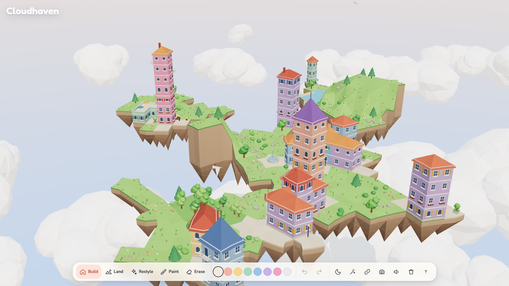
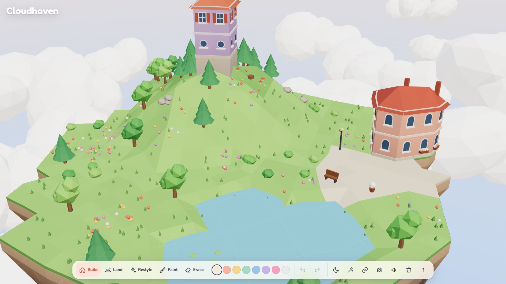
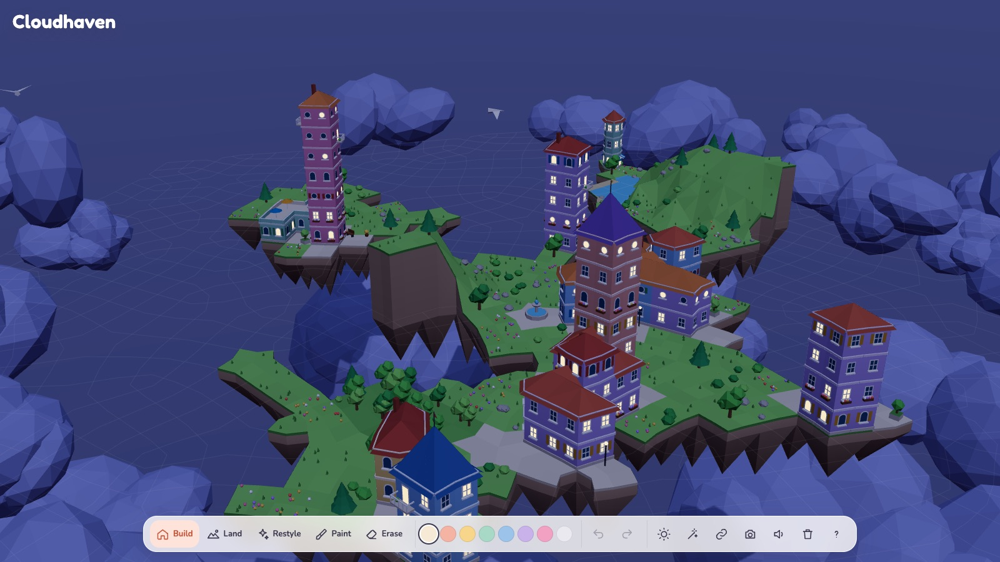
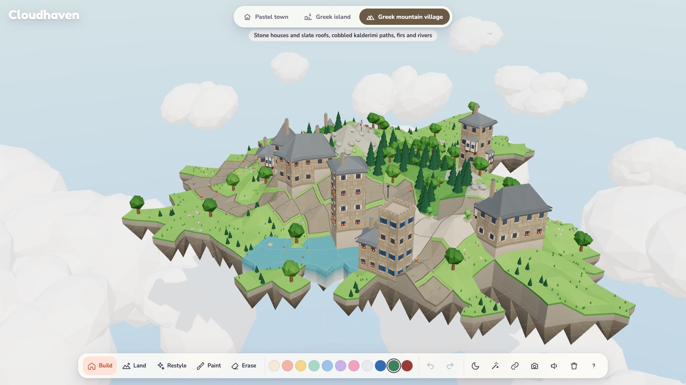
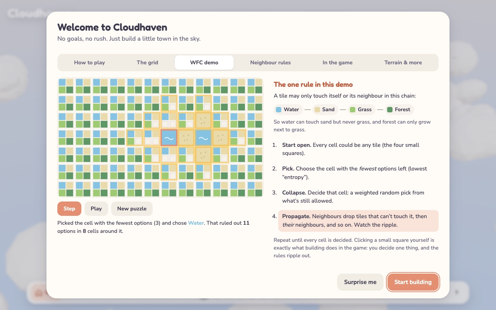

<p align="center">
  
</p>

<h1 align="center">Cloudhaven</h1>

<p align="center"><b>A cozy town builder on floating sky islands.</b><br>
No goals, no score, no rush: click to raise islands, stack little houses, shape hills, woods and lakes,<br>and watch the town work out the details for itself.</p>

<p align="center">
  
</p>

## Inspiration

Cloudhaven is a love letter to **[Townscaper](https://townscapergame.com/)** by **[Oskar Stålberg](https://oskarstalberg.com/)** (published by Raw Fury), the wonderful toy in which you click on the sea and a town grows itself. Townscaper is the clear reference for both the feel and the techniques: an irregular, relaxed quad grid, building on grid corners, and constraint solving that turns rough clicks into charming architecture.

This is an independent, non-commercial learning project, built from scratch. It isn't affiliated with Oskar Stålberg or Raw Fury and uses none of their code, models or art. Every piece in Cloudhaven is generated in code, and it has its own setting: villages in the sky with hills, forests, town squares and lakes.

The solver is based on **[Wave Function Collapse](https://github.com/mxgmn/WaveFunctionCollapse)** by Maxim Gumin.

The two Greek building styles are drawn from the vernacular architecture of the Cyclades and of the mountain villages of Zagori, Pelion and Mani. See [docs/greek-villages.md](docs/greek-villages.md) for the references and how each trait maps into the game.

## Features

- **Build by clicking.** Click the clouds to raise an island, click land or a roof to build up, click a wall to build sideways. Overhangs turn into arches and bridges.
- **Restyle anything.** Ask for a different version of any piece; its neighbours adapt so everything still fits.
- **Shape the land.** Paint meadow, woods, town squares or water, and click again to raise smooth hills. Lakes settle into basins with natural shorelines.
- **A town that decides the details.** Doors open onto squares, roofs join up, forests grow in stands, reeds line the shore, and boats drift in open water.
- **Day and night**, with glowing windows and lamps, drifting clouds, birds and gentle generated sound.
- **Undo/redo, autosave, share links** (the whole town is packed into the URL), **"Surprise me"** random towns and a picture button.
- **Greek island and mountain villages.** Build in a whitewashed Cycladic style (flat roofs, vaults, chapels with painted domes, windmills, bougainvillea) or a stone mountain style (slate roofs, wooden bays, stone bridges, Mani towers), or mix them in one town.
- **Mediterranean land.** Olive groves with cypresses and dry-stone walls, rocky hillsides with thyme, goats and roadside shrines, and village squares shaded by a plane tree.
- **A built-in visual guide** (the **?** button) with an interactive WFC demo, illustrated rules and the Greek references.

<table>
  <tr>
    <td></td>
    <td></td>
  </tr>
  <tr>
    <td align="center"><sub>Hills, woods, a lake and a town square</sub></td>
    <td align="center"><sub>Night falls and the windows light up</sub></td>
  </tr>
</table>

## Greek villages

<table>
  <tr>
    <td></td>
    <td></td>
  </tr>
  <tr>
    <td align="center"><sub><b>Island village</b>: whitewash, vaults, chapels and windmills</sub></td>
    <td align="center"><sub><b>Mountain village</b>: stone, slate, wooden bays and towers</sub></td>
  </tr>
</table>

Pick a **mode** with the switcher at the top centre: **Pastel town**, **Greek island** or **Greek mountain village**. The mode sets the architecture of new houses, the land types the Land tool offers, the colours of the landscape and the sky. **Surprise me** grows a whole settlement for that mode:

- **Greek island**: the island sits in a real turquoise sea, with low limestone cliffs and a line of surf. A whitewashed **Chora** crowns the hill, threaded with lanes and topped by windmills. A **port** at the shore has a quay, waterfront tavernas and moored caiques, and a whitewashed lane climbs from it to the Chora. Around them: dry summer hillside, phrygana scrub, olive groves, cypresses, oleander and chapels.
- **Greek mountain village**: floating mountains with fir and chestnut forest and limestone peaks. A stone village sits around a square with a plane tree, joined to outlying hamlets by cobbled **kalderimi** paths, with a river or lake below, stone bridges and tower houses.

On Greek buildings, the paint colour goes on the doors, shutters and domes instead of the walls. **Paint** applies the colour and the current mode's style, so you can convert a building and watch its neighbours adapt.

| Island (Cyclades) | Mountain (Zagori, Pelion, Mani) |
| --- | --- |
| Whitewashed cubes with flat roofs | Coursed local stone with wooden shutters |
| Rounded roofs: domes on lone houses, barrel vaults along rows | Grey slate roofs with deep slab eaves and tall chimneys |
| A lone one-storey house can become a **chapel** with a painted dome, cross and bell gable | Balconies become **sachnisia**, overhanging wooden bays |
| Lone towers can become **windmills** with canvas sails | Storeys spanning a gap become **stone arched bridges** |
| Bougainvillea, painted balconies, whitewashed paving joints, taverna awnings | Tall lone towers get **Mani-style** crenellated tops |

## Getting started

Requires [Node.js](https://nodejs.org/) 18 or newer.

```sh
npm install
npm run dev        # play at http://localhost:5173
```

| Command | What it does |
| --- | --- |
| `npm run dev` | Start the dev server with hot reload |
| `npm test` | Run the grid, WFC, terrain and geometry tests |
| `npm run build` | Typecheck and build a static site into `dist/` |
| `npm run preview` | Serve the production build locally |

The built site is fully static, so `dist/` can be hosted anywhere (GitHub Pages, Netlify, any web server).

## How to play

| Do this | To |
| --- | --- |
| Click the clouds | raise an island |
| Click land or a roof | build a storey on top |
| Click a wall | build sideways (overhangs become arches and bridges) |
| **Land** tool | paint the ground with the mode's land types (e.g. lanes, kalderimi, squares, olive groves, forest, sea); click the same land again to raise a hill |
| Mode switcher (top centre) | Pastel town, Greek island or Greek mountain village |
| **Restyle** tool or <kbd>Alt</kbd>/<kbd>⌥</kbd>-click | get a different version of a piece; its neighbours adapt |
| **Paint** tool or <kbd>Shift</kbd>-click | apply the selected colour and style to a building |
| **Erase** tool or right-click | remove a piece |
| Drag / right-drag / scroll | orbit / pan / zoom |
| <kbd>1</kbd>–<kbd>5</kbd>, <kbd>N</kbd>, <kbd>Ctrl/Cmd</kbd>+<kbd>Z</kbd>, <kbd>?</kbd> | tools, day/night, undo (add <kbd>Shift</kbd> to redo), guide |

**Start building** in the guide clears the town for a fresh start (Undo brings it back).

## How it works

<p align="center">
  
  <br><sub>The in-game guide includes an interactive Wave Function Collapse demo</sub>
</p>

### 1. An irregular grid (`src/grid.ts`)

The world starts as a hexagon of triangles. Random neighbouring pairs merge into quads, every shape is subdivided into smaller quads (a triangle into 3, a quad into 4), and then the points are **relaxed**: each quad is nudged, over many small steps, toward the closest perfect square. The result looks organic, but every cell still has exactly four corners.

You build on the grid's **corners**. Each corner owns the quarter of every quad that touches it, and together those quarters form its cell. A stack of cells is a column of **voxels**: land at the bottom, houses above.

### 2. Wave Function Collapse (`src/wfc.ts`, `src/tiles.ts`)

Every filled voxel is a variable that has to become one tile:

- **Storeys** combine a window style × a facade feature (plain, shutters, flowers, balcony, door, shop, chapel) × a roof (hip, steep, flat, rounded dome/vault, slate, windmill). Each building style allows its own subset.
- **Land** picks from its painted type: meadow (grass, flowers, tree, bush, rocks), woods (pines, oaks, grove, clearing), squares (paving, lamp, bench, planter, fountain, market stall, plane tree, kafeneio tables), water (open, lilies, reeds, boat, rock), olive grove (olives, cypresses, dry-stone wall, poppies) or rocky hillside (boulders, scrub, goat, shrine, stones).

**Context** narrows the options: roofs only on top floors, doors only on the ground floor facing walkable land, spires only on slim towers, chapels only on lone single-storey island houses, windmills only on lone island towers, reeds only on a shore, boats only in open water. **Neighbour rules** connect the pieces:

- storeys on the same floor share a window style, so a row of houses reads as one building;
- touching roofs share a type, so their ridges meet;
- no two doors side by side, and doors and shopfronts never open onto a tree, fountain, stall or planter;
- woods grow in pine or oak stands joined by mixed groves, and clearings never touch;
- squares keep fountains and lamps apart and have one plane tree;
- these rules apply between buildings of the **same style**; different styles can stand side by side with only the doorway rule.

The solver propagates the rules (arc consistency), collapses the variable with the fewest options left, and repeats. Two extra choices make it feel good to play with:

- **Local re-solving.** An edit only re-solves the area around it; the rest of the town stays fixed and acts as the boundary. If that area can't be solved, it grows until it can.
- **Stable randomness.** Each voxel has its own seed, which gives every option a fixed random score (an "exponential race"). The best-scoring option that's still allowed wins, so ruling out *other* options never changes the result. Building next door doesn't reshuffle your town, and the same town always looks the same. **Restyle** simply gives a piece a new seed and lets its neighbours re-solve around it.

### 3. Terrain (`src/builder.ts`)

Land stacks in solid columns, so a taller column is a hill. Each corner of a cell gets one height, computed from every cell that shares it, so neighbouring terrain always joins without cracks. Land averages its neighbours into smooth slopes. Water pulls its corners down into a basin, and the water surface reaches out over the banks so the rising ground cuts a natural shoreline. A lake above lower ground gets a rim to hold it in, and houses on slopes get stone foundations.

### 4. Procedural pieces (`src/builder.ts`, `src/geo.ts`)

There are no hand-made models. Each voxel's geometry is generated from its own irregular cell and its neighbours. Walls appear wherever a neighbouring quarter is empty. Roofs are a height field that is high in the middle of a building and low at the eaves, so joined houses share one roof. Overhangs get a vaulted underside that dips onto nearby walls, which is where arches and bridges come from. Windows, doors, balconies, chimneys, flags, trees, fountains and boats are placed with each voxel's seed, so they never jump around.

### 5. Everything else

- **Clicking** casts a ray into the scene. Every triangle carries a small "action" value saying what clicking it means: build on top, beside it toward a specific neighbour, or below.
- **Undo** keeps snapshots and rebuilds only the pieces that differ.
- **Saving** is automatic (browser storage). **Share** compresses the whole town (corner, level, type, colour and seed per voxel) into the link; tiles are re-solved when it opens.
- **Presentation** (`src/scene.ts`, `src/view.ts`): Three.js, flat-shaded low-poly pieces, soft shadows, instanced clouds, birds, a day/night cycle, springy pop-in animations, and sound effects synthesised with the Web Audio API (`src/audio.ts`).

## Project structure

```
src/
  grid.ts      irregular quad grid: triangles → merge → subdivide → relax, plus dual cells
  wfc.ts       generic graph Wave Function Collapse solver
  tiles.ts     tile catalogue, building styles, land types and neighbour rules
  town.ts      town state, editing, contexts, local re-solving, save/load
  builder.ts   procedural geometry: pastel, Cycladic and stone storeys, roofs, arches, terrain and props
  geo.ts       tiny mesh builder (flat-shaded, vertex-coloured, picking actions)
  generate.ts  "Surprise me": Chora + port island, mountain village with kalderimi, or pastel town
  modes.ts     the three modes: land palettes, landscape colours, sky and sea
  scene.ts     renderer, camera, sky, clouds, birds, day/night
  view.ts      voxel meshes, animations, hover ghost, grid lines
  help.ts      the in-game guide: tabs, grid diagrams, interactive WFC demo
  main.ts      input, tools, UI, history and persistence
tests/         grid validity, WFC constraints, terrain seams, Greek styles, geometry
docs/          screenshots and the Greek architecture references
```

Handy for screenshots: append `?cam=x,y,z,tx,ty,tz` to set the camera position and target, and `?night` to start at night.

## Built with

[Three.js](https://threejs.org/), [TypeScript](https://www.typescriptlang.org/), [Vite](https://vitejs.dev/) and [Vitest](https://vitest.dev/). Fonts: Fredoka and Nunito from Google Fonts.
