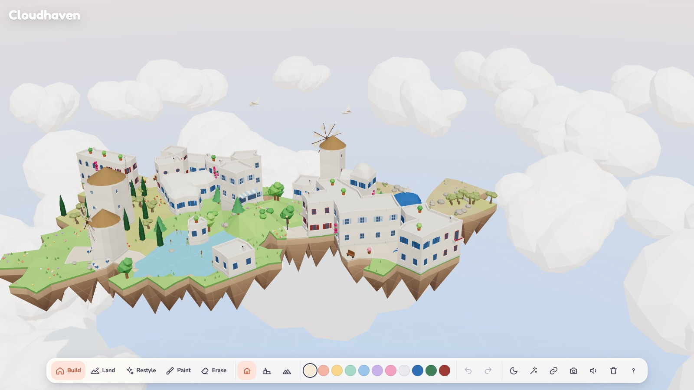
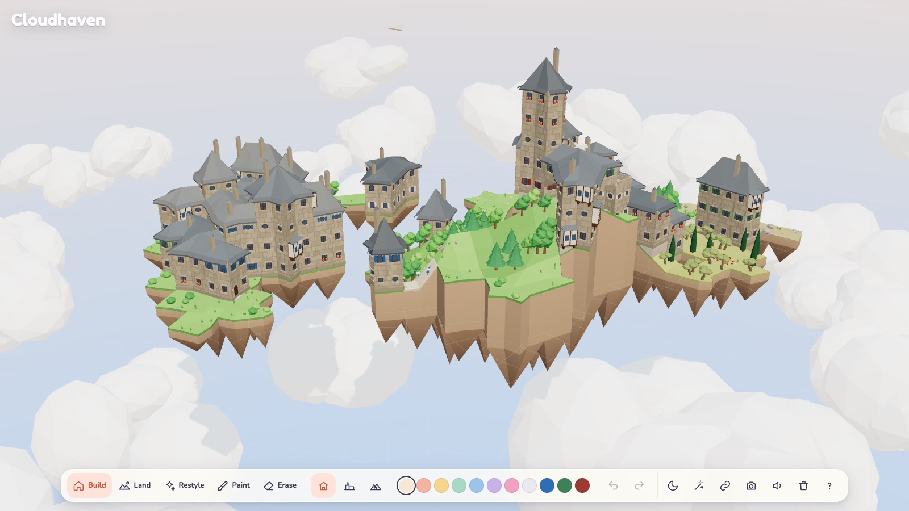
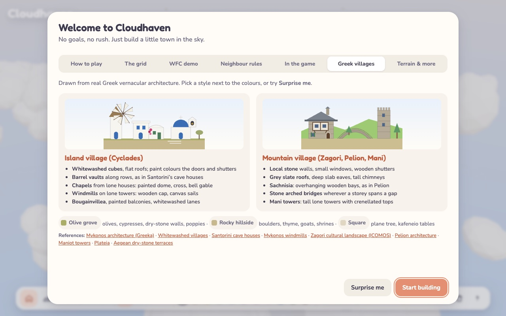

# Greek villages: references and how they map into Cloudhaven

Cloudhaven's two Greek building styles and its Mediterranean land types are based on the vernacular architecture of the Cyclades islands and of mountain villages in Epirus (Zagori), Thessaly (Pelion) and the Peloponnese (Mani). This page collects the references used and shows how each trait became a game piece or WFC rule.

| Island village | Mountain village |
| --- | --- |
|  |  |

## Island villages (Cyclades)

| What the references describe | In Cloudhaven |
| --- | --- |
| Cubic houses with **flat roofs** and **whitewashed walls**. The whitewash keeps interiors cool, and the flat roofs once collected scarce rainwater. Houses cluster tightly, often high above the sea. | **Island style** walls are whitewash. Flat terraces get low rounded parapets, Cycladic chimneys and potted plants. The WFC weights favour flat roofs for this style. The island generator clusters houses tightly. |
| **Painted details**: blue or green doors, shutters and window frames. (The blue-and-white image was also pushed by tourism campaigns, so colours vary in reality.) | On island houses the paint colour applies to doors, shutters, frames, railings and chapel domes rather than walls. The palette adds Aegean blue, shutter green and oxblood. |
| **Chapels** everywhere (Tinos alone has more than a thousand), with white walls and **blue, white, red or ochre domes**. | A lone, single-storey island house standing on the ground can become a **chapel** (a WFC context rule). A chapel always gets a dome (a tile combination rule), painted in your colour, with a cross and a whitewashed **bell gable** with a bronze bell. |
| **Barrel-vaulted** cave houses (*yposkafa*) in Santorini and Oia: long, narrow rooms with vaulted ceilings. | The **rounded roof** follows the footprint as a height field with a circular profile. It is a dome over a lone house and a barrel vault along a row of houses. |
| **Windmills**: round white towers with small windows, a conical wooden cap and triangular canvas sails, found across the Cyclades and most famously on Mykonos. | A lone island tower at least two storeys tall may get a **windmill cap** (a context rule). The cap is a wooden cone with eight spokes and canvas sails turned into a seeded wind direction. Windmill walls keep only a few small windows. |
| Bougainvillea, whitewashed lanes and steps, tavernas. | The *flowers* feature becomes **bougainvillea** spilling over the wall. Paving gets **whitewashed joints**, and shopfronts become striped **taverna** awnings. Balconies are solid whitewashed parapets with a painted rail. |

## Mountain villages (Zagori, Pelion, Mani)

| What the references describe | In Cloudhaven |
| --- | --- |
| Zagori's 46 villages are built almost entirely from **local stone, wood and slate**, blending into the mountains. | **Mountain style** walls are coursed stone in a running bond over darker mortar, with stone lintels, stone sills and wooden shutters (your paint colour). |
| **Grey slate roofs** (Pelion slate), projecting well beyond the walls to protect them from sun, rain and snow. | **Slate roofs** are low-pitched hips in slate grey, with deep eaves and a thick stone-slab edge. Tall stone chimneys have small slate caps. |
| Pelion mansions: thick grey stone walls carrying **overhanging wooden upper floors**, painted white, with covered wooden balconies. | The *balcony* feature becomes a **sachnisi**: a white plastered bay with a dark timber frame, small windows, wooden brackets and a slate hood. |
| Zagori's **stone arched bridges**, the historic links between villages. | Any storey that spans a gap gets a vaulted underside, which reads as a stone arch. The mountain generator deliberately adds bridges between houses. |
| **Mani tower houses**: three to five storeys of stone, with small windows and defensive tops. | A tall, lone mountain tower (three or more storeys) may end in a **crenellated flat top**. Slim mountain towers may instead get a steep slate spire. |

## Around the villages

| What the references describe | In Cloudhaven |
| --- | --- |
| The **village square** (*plateia*): a large plane tree for shade, a fountain or spring, the church and the *kafeneio*. | **Square** tiles add the **plane tree**, with its trunk whitewashed at the base, and **kafeneio tables** with blue chairs, next to the existing fountains, lamps and benches. WFC rules allow one plane tree per square and keep it away from fountains and doorways. |
| **Dry-stone terraces** are the defining human mark on Aegean landscapes, especially around **olive groves**. | New **Olive grove** land: gnarled olive trees, **cypresses**, dry-stone walls with an olive above, and poppies. Dry-stone walls never sit side by side. |
| Rocky, scrubby hillsides. | New **Rocky hillside** land: boulders, thyme scrub with purple flowers, loose stones, the odd **goat**, and roadside **shrines** (*kandylakia*) with a lit oil lamp. Goats and shrines are spaced apart. |

The in-game guide (**? → Greek villages**) summarises all of this with illustrations and links:

## How styles interact in the solver

- Each storey stores its style. Storeys of the **same style** on the same floor use the normal neighbour rules: shared window style and matching roof types.
- Storeys of **different styles** are linked by a looser relation (`REL_MIX` in `src/tiles.ts`) that only keeps the doorway rule. A stone house can stand next to a whitewashed one without forcing either to change.
- Roof geometry is shared only between neighbours of the same style. Where styles meet, both roofs come down to the eaves, so there are no gaps.
- **Paint** applies the selected colour *and* style, so you can convert a building and watch its neighbours re-solve.

## Sources

**Cyclades**
- [Mykonos architecture (Greeka)](https://www.greeka.com/cyclades/mykonos/architecture/)
- [The secret charm of Mykonian architecture (Culture Trip)](https://theculturetrip.com/europe/greece/articles/the-secret-charm-of-the-mykonian-architecture)
- [The best examples of Cycladic architecture (Travel Away)](https://travelaway.me/cycladic-architecture/)
- [Vernacular architecture of the Cyclades (ADF)](https://www.adfwebmagazine.jp/en/?p=267220)
- [Sifnos architecture (Greeka)](https://greeka.com/cyclades/sifnos/architecture)
- [20 whitewashed villages in Greece (The Mediterranean Traveller)](https://www.themediterraneantraveller.com/greece-white-buildings/)
- [Why are Greek island homes blue and white?](https://elxis.com/index.php/why-are-greek-island-homes-blue-and-white)

**Santorini cave houses**
- [Santorini iposkafa and their secrets (Aegean Islands)](https://www.aegeanislands.gr/pois/santorini-iposkafa-cave-houses-and-their-secrets-en/)
- [Cave houses in Santorini](https://www.swulinski.com/travels/CaveHousesSantorini.html)
- [Santorini cave dwellings (Studio Matrx)](https://www.studiomatrx.org/architecture-canon/santorini-cave-dwellings)

**Windmills**
- [Mykonos windmills (Wikipedia)](https://en.wikipedia.org/wiki/Mykonos_windmills)
- [Windmills of Mykonos: the history of a landmark (Greek Reporter)](https://greekreporter.com/2023/05/15/windmills-mykonos-history/)
- [The stone giants of the Aegean (Visit Greece)](https://www.visitgreece.gr/inspirations/windmills/)

**Zagori**
- [The Zagori cultural landscape (ICOMOS)](https://landscapes.icomos.org/zagori-greece/)
- [Zagori (Wikipedia)](https://en.wikipedia.org/wiki/Zagori)
- [Zagori (Visit Greece)](https://www.visitgreece.gr/mainland/epirus/zagori/)
- [Zagorochoria architecture (Greeka)](https://greeka.com/epirus/zagorochoria/architecture)

**Pelion**
- [Mount Pelion architecture (Visit Greece)](https://www.visitgreece.gr/en/experiences/architecture/local-architecture/mount-pelion-architecture)
- [Architecture of Pelion (Around Pelion)](https://aroundpelion.com/architecture)
- [Pelion mansions (Greeka)](https://greeka.com/thessaly/pelion/sightseeing/mansions)
- [Museum of Folk Art and History of Pelion (Wikipedia)](https://en.wikipedia.org/wiki/Museum_of_Folk_Art_and_History_of_Pelion)
- [Karagiannopoulos Mansion case study, PLEA 2009](https://web.faaad.ulaval.ca/plea2009/Papers/2.STRATEGIES/2.3%20Post-Occupancy%20Evaluation/POSTER/2-3-19-PLEA2009Quebec.pdf)

**Mani**
- [Maniot towers (Visit Peloponnese)](https://visitpeloponnese.com/en/prdct/maniot-towers)
- [A travel guide to the tower houses of Inner Mani (Greek City Times)](https://greekcitytimes.com/2025/12/03/mani-towers-in-lakonia/)
- [Mani Peninsula (Wikivoyage)](https://en.wikivoyage.org/wiki/Mani_Peninsula)

**Village squares and landscape**
- [Plateia (Wikipedia)](https://en.wikipedia.org/wiki/Plateia)
- [Why Greek villages have a giant plane tree in their main square (Greek Reporter)](https://greekreporter.com/2026/09/03/greek-village-plane-tree-square/)
- [LIFE TERRACESCAPE: terraced landscapes of the Aegean (Climate-ADAPT)](https://climate-adapt.eea.europa.eu/en/metadata/projects/employing-land-stewardship-to-transform-terraced-landscapes-into-green-infrastructure-to-better-adapt-to-climate-change)
- [Kizos & Koulouri, agricultural landscape dynamics in the Aegean (Human Ecology Review)](https://www.humanecologyreview.org/pastissues/her122/kizoskoulouri.pdf)

Many of these are travel and heritage-tourism sources. They are good for the look and feel the game draws on, but details such as counts and dates vary between them.
